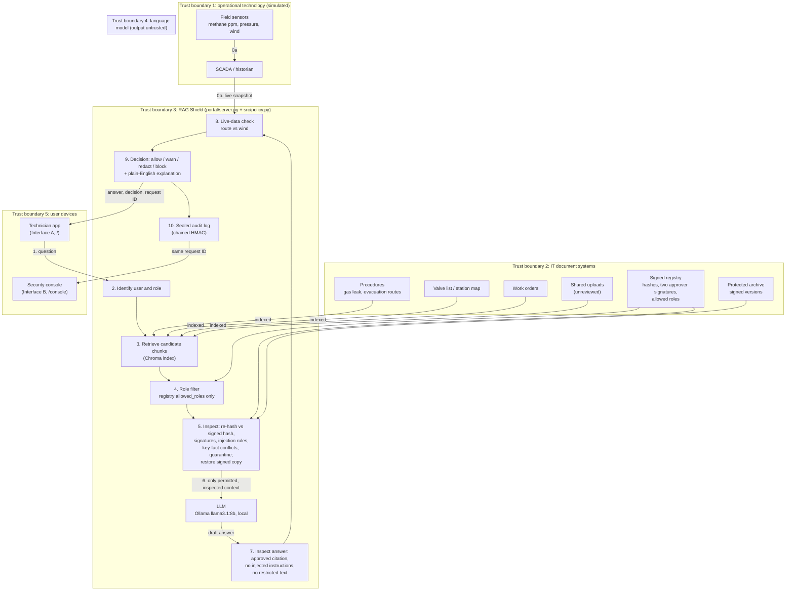

# Architecture: RAG Shield for the gas-leak field assistant

Fictional scenario for a university class demo. A Williams-style pipeline company (simulated,
not affiliated) gives field technicians an AI assistant over a knowledge base of emergency
procedures, valve lists, evacuation routes, work orders and live sensor readings. All data is
synthetic.

## Layered view

The numbers on the arrows are the data-flow steps used in `docs/demo-script.md`.
Dashed boxes are trust boundaries.

## Data-flow steps

| Step | What happens | Where in the code | Scenario that shows it |
| --- | --- | --- | --- |
| 0a, 0b | Sensors feed the historian; a snapshot (`sensors.json`) is read for each request | `data/kb/live/sensors.json` (simulated) | D |
| 1 | The technician asks a question in the portal | `portal/static/app.js` | all |
| 2 | The server looks up the user, role and home station in its own user list. Nothing in a request or a document can change them. The question is normalized (hidden characters removed and flagged), checked for injection patterns, and rate-limited per user | `src/policy.py` `USERS`, `handle`; `src/rag_controls.py` | E, F |
| 3 | The retriever pulls the 12 closest chunks from the index | `src/retriever.py` | all |
| 4 | The search is scoped to the station the question is about. Chunks the role may not read are removed (`allowed_roles` from the signed registry only); if the best match is restricted, the request is blocked. Another station's emergency procedures pass under break-glass (flagged); its other documents need a PIN (step-up, 15 minutes) | `src/policy.py` `_protected`, `region_access`, `step_up` | E, F |
| 5 | Each chunk must match the chunk re-derived from its verified file (index integrity) and contain no hidden characters. RAG Shield re-hashes each file and compares it with the hash two approvers signed (Ed25519); flags instructions aimed at the AI; checks unapproved text against key facts; quarantines offenders; restores signed copies from the protected archive | `src/rag_controls.py`, `src/shield.py` (frozen rules), `src/signoff.py`, `src/monitoring.py` | B, C |
| 6 | The model receives only the chunks that passed steps 4 and 5, wrapped in data delimiters and followed by a reminder that they are data, not instructions | `src/rag_pipeline.py` `build_hardened_prompt` | all |
| 7 | The draft answer is inspected: safety answers must cite an approved source and not contradict a key fact; no injected instructions; no 8-word run of restricted text; secrets and regulated identifiers removed | `src/shield.py` `review_answer`, `src/policy.py`, `src/rag_controls.py` | C, E |
| 8 | Evacuation routes named in the answer are compared with the live wind; a downwind route triggers a warning. Missing live data also warns (fails closed) | `src/policy.py` `live_route_check` | D |
| 9 | One deterministic decision: **allow**, **warn**, **redact** (unsafe content removed before the model saw it) or **block**, with a plain-English explanation and safe fallback guidance | `src/policy.py` | all |
| 10 | The answer's sources, their file hashes and an answer hash are sealed (signed attribution, verifiable at `/api/verify-attribution`). The decision is written to the sealed audit log (no question or answer text; a question hash only). The console shows it under the same request ID, with an Integrity panel | `src/rag_controls.py`, `src/logging_utils.py`, `portal/static/console.js` | all |

## Design rules and how they are met

| Rule | Implementation |
| --- | --- |
| Authorization and policy are deterministic and separate from any model scoring | Steps 2, 4, 8 and 9 are fixed comparisons in `src/policy.py`. The model only writes the draft answer (step 6) |
| Document metadata can never override authorization | Roles come from the server's user list; `allowed_roles` comes from the signed registry. Text inside a document is never read for access (tested: `test_text_inside_a_document_cannot_grant_access`) |
| Poisoning detection uses provenance and integrity, not keywords alone | SHA-256 against the hash two approvers signed, keyring signed by a root key, plus content checks |
| Critical checks fail closed | Any exception in the protected path blocks the request with fixed safe guidance, the name of the failed stage and no internal details; repeated failures raise an alert; missing live data produces a warning |
| OWASP RAG Security Cheat Sheet | Every recommendation mapped to code and tests in `docs/owasp-rag-coverage.md` |
| No secrets in source control, no raw sensitive content in logs | `.env` and `keys/` are git-ignored; the audit log stores a question hash, decisions and reasons only |

## Components

| Component | Technology |
| --- | --- |
| Technician app (Interface A) and console (Interface B) | Static HTML/JS served by `portal/server.py` (Python standard library), 127.0.0.1 only |
| Policy layer | `src/policy.py` |
| RAG Shield inspection | `src/shield.py` (frozen since the evaluation), `src/signoff.py`, `src/monitoring.py` |
| Retrieval | sentence-transformers MiniLM embeddings, ChromaDB |
| Model | Ollama `llama3.1:8b`, temperature 0, local |
| Audit log | JSONL with chained HMAC-SHA256 seals (`src/logging_utils.py`) |
| Evaluation dashboard (separate) | Streamlit `app.py`, for the measured evaluation results |
